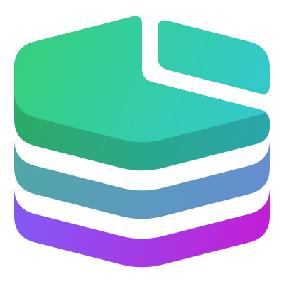

<p align="center">
  
</p>

<h1 align="center">SlideCompose</h1>

<p align="center">A framework for slides written in Jetpack Compose</p>

Write slides in Jetpack Compose (Compose Multiplatform for Desktop) and present them on a Mac.

## Features

- **Slides are `@Composable` functions**: they are Kotlin code, so they can hold state, buttons and animations.
- **Presenter window**: the current and next slides and the notes, apart from the slides the audience sees. Slides react to clicks there too, and the pointer is shared.
- **Hot reload**: the app compiles the deck while it runs and reloads it every time you save.

## Requirements

- macOS
- JDK 17 or later, to build (Gradle downloads the JDK bundled in the app on the first build)

## Quick start

Build the app and open the demo.

```sh
./gradlew :viewer:createDistributable
open -a viewer/build/compose/binaries/main/app/SlideCompose.app examples/demo
```

`→` or `Space` goes forward, `←` back. `⌥⌘P` starts the presentation.

For your own slides, use File > New Deck… for a template, or write a `.kt` file like the one below and open it.
The app reloads it every time you save it in your editor.

A deck can run any code. Before compiling a deck for the first time, the app asks whether you trust it.
Decks you do not trust can be opened in safe mode ([The app](docs/app.md)).

## Your first deck

Declare a top-level `val deck = presentation { ... }` and add slides with `slide { ... }`.

```kotlin
import io.github.munetoshi.slidecompose.deck.*
import io.github.munetoshi.slidecompose.deck.components.*

val deck = presentation(title = "My Talk") {
    slide(notes = "Speaker notes") {
        TitleSlide("My Talk", "subtitle")
    }

    slide {
        TitleAndContent("Agenda") {
            Bullet("one")
            Reveal(atStep = 1) { Bullet("two") }    // comes in on a click (a build step)
            Reveal(atStep = 2) { Bullet("three") }
        }
    }
}
```

Slides are plain Compose and Kotlin, so values and parts can be shared as `val`s and functions.

- The app opens a single `.kt` file or a folder; relative paths, such as those of images, start from that folder
- The demo ([examples/demo/Demo.kt](examples/demo/Demo.kt)) shows most features

### Arguments of `presentation` and `slide`

| Argument | What it does |
| --- | --- |
| `presentation(size = …)` | The size of the slides. The default `SlideSize.Widescreen` is 1920x1080 (1.dp = 1 unit) |
| `presentation(theme = …)` | `SlideTheme.Light`, `SlideTheme.Dark` or your own ([Themes and styles](docs/theme-and-style.md)) |
| `presentation(duration = …)` | The length of the talk; the presenter window then shows a time bar |
| `background { … }` | A background behind every slide (it does not transition) |
| `style { … }` | Defaults for animations ([Themes and styles](docs/theme-and-style.md)) |
| `slide(notes = …)` | Speaker notes; `listOf(…)` for a note per build step |
| `slide(duration = …)` / `slide(weight = …)` | The planned time of the slide, or its share of the time |
| `slide(steps = …)` | The number of build steps, when the slide reads `step` itself |
| `slide(theme = …)` | A theme for this slide alone, such as `SlideTheme.Dark` |
| `transition = …` | The slide transition: the default in `presentation`, the way into the slide in `slide` |

### Build steps

A slide can be shown in several steps, called build steps.

- What is in `Reveal(atStep = 1) { … }` fades in at that build step (`offset = 24.dp` makes it rise from below)
- The number of build steps follows from the `Reveal`s
- `SlideScope` gives `step`, `steps`, `slideIndex` and `slideCount`

### Slide elements

| Element | What it is |
| --- | --- |
| `TitleSlide`, `TitleAndContent` | A title slide; a slide with a title and content |
| `Bullet`, `SlideText` | A bullet; text |
| `Reveal` | What comes in at a build step |
| `CodeBlock` | Code ([Code blocks](docs/code-block.md)) |
| `AssetImage`, `assetPainter` | Images (PNG, JPEG, SVG and more) |
| `SlideNumber` | The page number |

Text between backticks becomes inline code: ``Bullet("Reads `step`")``.
For text of your own, `SlideText("…")` in place of `Text` shows inline code too.

### Slide transitions

| Transition | What it does |
| --- | --- |
| `SlideTransition.ElementTransition()` | The default: elements with the same id move (element transitions) |
| `SlideTransition.Fade()` / `Push()` / `None` | Fade / push / none |

### Element transitions

Elements with the same id move from slide to slide ([Element transitions](docs/element-transition.md)).

```kotlin
slide { TitleSlide("My Talk", titleId = "title") }
slide { TitleAndContent("My Talk", titleId = "title") { Bullet("...") } }
```

### Code blocks

`CodeBlock` shows code, moving between versions at build steps, and editable on the slide with `editable = true`.

```kotlin
import io.github.munetoshi.slidecompose.deck.code.*

slide { CodeBlock("""fun main() = println("Hello")""", focusLines = 1..1) }

// A version of the code per build step: code that stays moves, code added comes in
slide(steps = versions.size) { CodeBlock(versions, version = step) }
```

## Presenting

| Key | Action |
| --- | --- |
| `→` `Space` `Enter` / click | Next |
| `←` `Backspace` | Previous |
| Number + `Enter` | Go to that slide |
| `⌥⌘P` | Play (the slides full screen on an external display, the presenter window on yours) |
| `F` | Toggle full screen |
| `P` | Open or close the presenter window |
| `B` | Black screen for the audience |

The presenter window shows the current and next slides, the notes, the time and progress bars.
All keys and the presenter window are in [Presenting](docs/presenting.md).

## Exporting a PDF

Use File > Export PDF… (`⌘E`), or the command line.

```sh
SlideCompose.app/Contents/MacOS/SlideCompose --pdf out.pdf examples/demo
SlideCompose.app/Contents/MacOS/SlideCompose --pdf out.pdf --builds examples/demo  # a page per build step
SlideCompose.app/Contents/MacOS/SlideCompose --png out/ examples/demo
```

## Running a deck from code

The library is not published to a Maven repository yet.
Inside this repository, a module can depend on it and run a deck without the app.

```kotlin
// build.gradle.kts of a module in this repository
dependencies {
    implementation(project(":slidecompose"))
    implementation(compose.desktop.currentOs)
}
```

```kotlin
import io.github.munetoshi.slidecompose.player.window.runPresentation

fun main() = runPresentation(deck, assetDirectory = File("path/to/assets"))
```

`./gradlew :demo-runner:run` starts the demo this way (without hot reload).

## Documentation

| Document | Contents |
| --- | --- |
| [The app](docs/app.md) | Building, opening decks, safe mode, the command line |
| [Code blocks](docs/code-block.md) | `CodeBlock`: versions, focus, folds, editing |
| [Themes and styles](docs/theme-and-style.md) | Colors, fonts, the look of elements, animation defaults |
| [Element transitions](docs/element-transition.md) | How elements move, how text changes |
| [Presenting](docs/presenting.md) | Keys, playing, the presenter window |
| [Exporting PDF / PNG](docs/pdf.md) | Choosing the build steps to export |
| [Development](docs/development.md) | Structure, how it works, tests, licenses, distribution |

## Development

```sh
./gradlew test                    # tests of the library and the app
./gradlew :demo-runner:snapshots  # every slide and transition of the demo as images
```

See [Development](docs/development.md) for the structure and how it works, and [Contributing](CONTRIBUTING.md) to send changes.

## License

SlideCompose is licensed under the [Apache License 2.0](LICENSE). Copyright 2026 munetoshi

The software bundled in the app keeps its own licenses ([THIRD_PARTY_NOTICES.md](THIRD_PARTY_NOTICES.md)).
